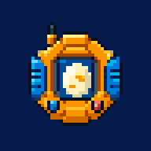

# DigiMMO Client



An unofficial client for [DigiMMO](https://play.digimmo.com.br/), with optional lighting, moving treetops, shadows, reflections and regional ambience. Available as a Windows or Linux app, browser extension or userscript. Visuals and sound only; no gameplay automation.

## [Download for Windows](https://github.com/dadero-deadline/digimmo-client/releases/latest/download/DigiMMO.zip)

1. Download **DigiMMO.zip**.
2. Extract it into its own folder.
3. Open **DigiMMO.exe** and play.

Windows 64-bit. Keep the supporting files beside the EXE. Updates download automatically: install them from the start window before you play, or they install after you close the client. Login and settings are kept. The EXE is unsigned.

## [Download for Linux](https://github.com/dadero-deadline/digimmo-client/releases/latest/download/DigiMMO-x86_64.AppImage)

1. Download **DigiMMO-x86_64.AppImage**.
2. Make it executable: `chmod +x DigiMMO-x86_64.AppImage`, or tick **Allow executing as program** in its properties.
3. Open it and play.

Linux 64-bit, tested on Ubuntu. No installation needed. Updates download automatically and replace the file, from the start window before you play or after you close the client. The browser folders below are in the Windows ZIP.

[Latest release](https://github.com/dadero-deadline/digimmo-client/releases/latest) · [Update help](UPDATES.md) · [Report a problem](https://github.com/dadero-deadline/digimmo-client/issues/new?template=bug_report.md)

## What changes?

Warm lights at night, foliage in the wind and ambient sounds that change with the area and time of day. Adjust the effects in **F10**, or switch them off at any time. The atmosphere clock can follow your local computer time, repeat a shorter day or stay at a time you choose. The desktop client opens with a start window showing the game's latest patch notes and how many players are online, read from the game's public API; turn it off in **F10**. An optional players online counter in the game can be switched on there too and dragged anywhere. While Discord is open, the desktop client shows DigiMMO as your current game; Discord's activity privacy settings can hide it.

## Prefer your browser?

The ZIP also includes two optional folders. Choose one:

| Folder | How to use it |
| --- | --- |
| `extension/` | In Chrome or Edge, enable Developer mode on the extensions page and select **Load unpacked**. Choose this folder, then reload the game. |
| `scripts/` | Install `digimmo-tweaks.user.js` with your userscript manager. |

Both use the same effects as the client. Browser copies need manual updates. [Browser instructions](extension/README.md)

## Controls

| Key | Action |
| --- | --- |
| **F10** | Open settings |
| **Alt+F10** | Toggle visual atmosphere |
| **Ctrl+F10** | Toggle ambience |
| **F11** | Toggle fullscreen in the client |

Settings support English, Español and Português (Brazil). [All keyboard controls](KEYBOARD.md)

## Known issues

No issues are open at the moment. DigiMMO itself is updated regularly, so new or redrawn artwork can briefly lack lights or movement until the client catches up. If something looks or sounds wrong, [report it](https://github.com/dadero-deadline/digimmo-client/issues/new?template=bug_report.md) with the map, time of day and a screenshot. [Resolved issues](https://github.com/dadero-deadline/digimmo-client/issues?q=is%3Aissue+is%3Aclosed)

## Source and contributions

<details>
<summary>Source folders and development</summary>

GitHub's green **Code → Download ZIP** button downloads the source, not the playable client.

```text
src/        Shared effects, ambience and lighting data
client/     Desktop app and automatic updater
extension/  Browser extension template
assets/     Audio recordings and artwork
scripts/    Build and verification tools
```

Requires Node.js 22.12 or newer, npm and Windows. Run `npm ci`, then `npm start` to build and launch the development EXE. Generated files stay under `dist/`; release packages go to `../release/<version>/`. The Linux AppImage is built on Linux or WSL with `npm run package:linux`.

Work in your own fork and submit a focused pull request for maintainer review. Only the maintainer merges changes and publishes official releases. See [Contributing](CONTRIBUTING.md) for build and release instructions.

</details>

## Credits and license

The official DigiMMO icon was supplied by Jorge. See [sound and artwork credits](SOUND_CREDITS.md) and the in-game Changelog tab for asset attribution. [Changelog](CHANGELOG.md)

Code and documentation use the [MIT License](LICENSE): use, modify and redistribute them while keeping the copyright and license notice. Sounds, artwork and dependencies retain their own licenses. This is an unofficial project.
